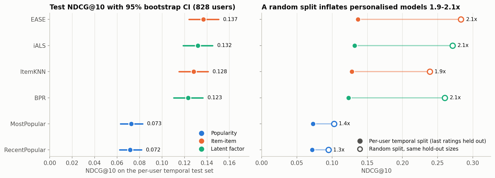
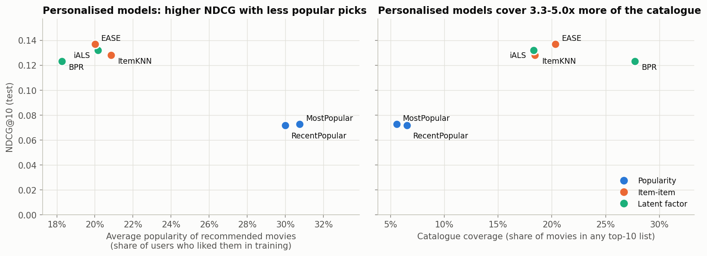
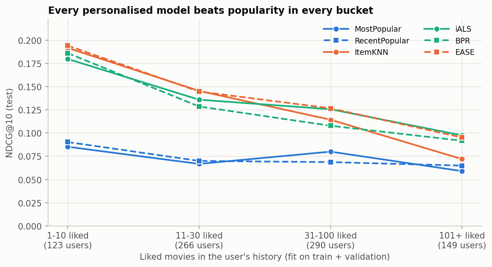
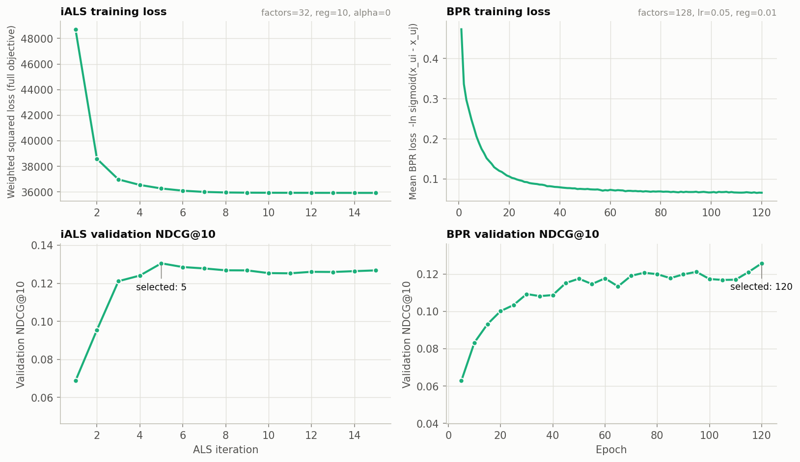

# MovieLens Top-N Recommender (`recsys`)

Top-N movie recommendation evaluated without leakage: a temporal split, strong simple baselines,
and implicit ALS, BPR and EASE^R built from scratch in NumPy/SciPy, compared on accuracy
**and** on popularity bias.

[](https://github.com/faiqrasulov/movielens-recommender/actions/workflows/ci.yml)

[](LICENSE)

## Key results

MovieLens 100K. The test set is each user's last ratings; `make run` (about 2-3 minutes on a laptop
CPU) produces every number below and stores it in [`reports/metrics.json`](reports/metrics.json).

- **EASE^R is the most accurate model:** NDCG@10 **0.137** (95% CI 0.124-0.150) over 828 users,
  **1.9x the most-popular baseline** (0.073; paired difference +0.064, CI +0.051 to +0.077).
  iALS (0.132) is statistically tied with it (difference +0.005, CI -0.001 to +0.011).
- **A random split would have doubled every personalised score** (1.9-2.1x; EASE 0.283) and
  inflated the gain over popularity from +0.064 to +0.181 NDCG.
- **Accurate and less popularity-biased:** personalised models recommend movies liked by 18-21% of
  users (most-popular baseline: 31%) and use 18-28% of the catalogue (baseline: 5.6%). BPR covers the
  most (27.7%) but is the least accurate personalised model.
- **Cold start is the real constraint:** with a strict global time cutoff, 76 of the 153 users who
  were active after the cutoff have no history at all. For the 76 who do, a recent-popularity
  baseline (0.197) comes within 0.03 of the personalised models (0.209-0.224, CIs about +/-0.06).



## Problem & why it matters

The ranked lists on a streaming or shopping home page decide what most people see and buy, so
small gains in ranking quality matter. The hard part is measuring that quality offline. Two
mistakes are common:

1. **Random train/test splits.** They train on what the user did *after* the moment being
   predicted and hide random ratings from the same session. On this data that doubles NDCG for
   every personalised model and almost triples their apparent gain over popularity (measured
   below).
2. **Accuracy-only scoreboards.** Recommending the blockbusters everyone has heard of scores
   reasonably well (29% of users get at least one hit from a non-personalised most-popular list)
   while showing 94% of the catalogue to no one. Coverage and popularity metrics have to sit next to accuracy.

This project builds the evaluation first (temporal splits, full-catalogue ranking, bootstrap
confidence intervals, beyond-accuracy metrics) and then compares five model families on it.

## Approach

**Implicit-feedback framing.** A rating of 4 or 5 counts as a positive ("watched and liked",
55.4% of ratings). Ratings of 1-3 are not used as positives: a 2-star rating means the user watched
the film and disliked it, and training on it as a positive would teach the model to recommend
disliked films. Every rated movie, whatever the rating, is excluded from that user's
recommendations: a watched film is never a useful recommendation. All models rank the full
catalogue of 1,682 movies (no sampled negatives).

**Leakage-free split (main protocol).** For each user, the 5 most recent ratings are the test set
and the 5 before them the validation set. MovieLens stored ratings in batches: 75.8% of ratings
share their second with another rating by the same user. So the cut is moved to the start of a
batch, and every training rating is *strictly earlier* than every held-out rating of that user
(test sets have 5-14 ratings, median 5). Hyperparameters are chosen on validation; the test set is
used once, after refitting on train + validation.

**Two more protocols run with the same tuned models.**
- *Random split* with exactly the same number of held-out ratings per user. Only the time order
  differs, so any change in the scores is caused by that.
- *Global time split* (cutoffs 1998-03-07 and 1998-03-31): no model sees anything after the moment
  it is evaluated, not even other users' later ratings, which the per-user split still allows.
  This is the deployment-like setting, but 67.7% of users rated everything within one day, so only
  76 users have both a history and a future.

**Models** (all from scratch; no `implicit`, `surprise` or deep-learning libraries):

| Model | What it is | Key design decision |
|---|---|---|
| MostPopular | Count of positives per movie | The baseline every model must beat |
| RecentPopular | Positives in the last *W* days before each user's recommendation time | Counts only events strictly before that user's own cutoff, so it never sees the future; *W* tuned (7-120 days or all) |
| ItemKNN | Shrunk cosine `c_ij / (n_i n_j + s)` (co-likes over the product of the items' norms plus shrinkage), top-*k* neighbours per item (Sarwar et al. 2001) | *k* and *s* tuned |
| iALS | Weighted least squares over **all** user-movie pairs with confidence `1 + alpha*r` (Hu, Koren & Volinsky 2008) | Conjugate-gradient ALS (Takacs et al. 2011): 3 warm-started CG steps per half-iteration, vectorised across all users, never forms the f x f systems. An exact batched solver is the tested reference. The full objective is tracked every iteration |
| BPR | Pairwise loss `-ln sigmoid(x_ui - x_uj)` with uniform negative sampling (Rendle et al. 2009) | Vectorised mini-batch SGD with sparse scatter-add updates; item bias stored as an extra factor column; epochs chosen from the validation curve |
| EASE^R | Closed form `B = I - P diag(1/diag P)`, `P = (X'X + lambda I)^-1`, `diag(B) = 0` (Steck 2019) | One hyperparameter, one 1,682 x 1,682 matrix inverse |

**Metrics** (from scratch, k = 10): Precision, Recall, NDCG (binary gain, ideal list of
`min(k, #relevant)` hits), MAP, HitRate; catalogue coverage; average popularity of recommended
movies (share of training users who liked them); novelty (mean `-log2 p(movie)`, in bits). 95%
confidence intervals come from a percentile bootstrap over users (2,000 resamples); model
differences use a paired bootstrap (same users resampled for both models).

**Tuning.** 74 configurations over the six models, scored by validation NDCG@10. For iALS and BPR
the number of iterations/epochs is read off the validation curve of each run.

**Tests** (30, about 2 s, no network): metrics against hand-computed answers and scikit-learn's
`ndcg_score`; every split checked for strict time order; EASE against column-by-column ridge
regressions; the ALS objective and solves against dense brute-force references, a monotone
objective, and recovery of planted block and low-rank structure; item-kNN on a toy matrix
with hand-computed similarities; BPR on planted blocks; no seen item ever recommended; pipeline,
CLI and offline-download smoke tests on synthetic data.

## Results

### Test set (per-user temporal split, 828 users, 3,201 held-out positives)

| Model | Precision@10 | Recall@10 | NDCG@10 (95% CI) | MAP@10 | HitRate@10 | Coverage | Avg. popularity | Novelty (bits) |
|---|---:|---:|---:|---:|---:|---:|---:|---:|
| MostPopular | 0.039 | 0.086 | **0.073** (0.063-0.083) | 0.038 | 0.286 | 5.6% | 30.8% | 1.73 |
| RecentPopular | 0.039 | 0.086 | **0.072** (0.062-0.082) | 0.038 | 0.277 | 6.5% | 30.0% | 1.78 |
| ItemKNN | 0.066 | 0.158 | **0.128** (0.115-0.141) | 0.074 | 0.406 | 18.4% | 20.8% | 2.41 |
| iALS | 0.073 | 0.170 | **0.132** (0.119-0.145) | 0.074 | 0.431 | 18.3% | 20.2% | 2.44 |
| BPR | 0.068 | 0.159 | **0.123** (0.110-0.136) | 0.070 | 0.406 | 27.7% | 18.3% | 2.67 |
| EASE | 0.072 | 0.167 | **0.137** (0.124-0.150) | 0.079 | 0.434 | 20.3% | 20.0% | 2.47 |

Tuned settings: RecentPopular window 120 days; ItemKNN k = 200, shrinkage 10; iALS 32 factors,
reg 10, alpha = 0, 5 iterations; BPR 128 factors, lr 0.05, reg 0.01, 120 epochs; EASE lambda = 300.

- Every personalised model beats MostPopular with a paired 95% CI well above zero (ItemKNN
  +0.055, iALS +0.059, BPR +0.050, EASE +0.064 NDCG; bootstrap p < 0.001 for all).
- The four personalised models are close: EASE leads iALS by +0.005 (CI -0.001 to +0.011,
  p = 0.10), and all four CIs overlap.
- Validation and test agree on the top two: EASE 0.131, iALS 0.130, BPR 0.126, ItemKNN 0.122 on
  validation vs 0.137, 0.132, 0.123, 0.128 on test (BPR and ItemKNN swap places).

### The evaluation protocol changes the answer

The same tuned models, NDCG@10 under three protocols (global split: 95% CI in brackets).

| Model | Random split (918 users) | Per-user temporal, main (828 users) | Global time split (76 users) |
|---|---:|---:|---:|
| MostPopular | 0.103 | 0.073 | 0.154 (0.107-0.210) |
| RecentPopular | 0.095 | 0.072 | 0.197 (0.145-0.256) |
| ItemKNN | 0.239 | 0.128 | 0.214 (0.153-0.282) |
| iALS | 0.271 | 0.132 | 0.224 (0.164-0.293) |
| BPR | 0.260 | 0.123 | 0.209 (0.150-0.274) |
| EASE | 0.283 | 0.137 | 0.216 (0.160-0.279) |

- **Why random splits overestimate.** With per-user hold-out sizes held fixed, randomising *which*
  ratings are held out multiplies NDCG by 1.9-2.1 for the personalised models but only by
  1.3-1.4 for the popularity baselines. A random hold-out lets the model train on the user's
  later tastes, and because most ratings were entered in same-second batches it puts movies
  rated together on both sides of the split, where co-occurrence makes them easy to predict.
  The result: the measured value of personalisation (EASE minus MostPopular) grows from +0.064
  to +0.181 NDCG, and BPR and ItemKNN swap places (both within their CIs).
- **Recency only matters when the clock is honest.** Under the per-user split, RecentPopular
  equals MostPopular (difference -0.001, CI -0.005 to +0.003): users' recommendation times are
  spread over seven months. Under the global split, where every user is evaluated after the
  same date, it beats MostPopular (0.197 vs 0.154) and gets close to the personalised models.
- Absolute values are not comparable across columns: the global-split users are the 76 long-term
  users with 20 held-out positives each on average (1,539 in total), which raises every score.
  With 76 users the CIs are about +/-0.06, too wide to rank the models.

### Accuracy vs popularity bias and coverage



The baselines recommend movies liked by 30-31% of all users and reach 5.6-6.5% of the catalogue.
The personalised models are 1.7-1.9x as accurate while recommending less popular movies
(18-21%) and covering 3.3-5.0x more of the catalogue. Among them there is a trade-off: BPR has the
widest coverage (27.7%) and the highest novelty (2.67 bits) but the lowest NDCG (0.123); EASE is
the most accurate with mid-range coverage (20.3%).

### Light vs heavy users (cold-start discussion)



| Liked movies in history | Users | MostPopular | RecentPopular | ItemKNN | iALS | BPR | EASE |
|---|---:|---:|---:|---:|---:|---:|---:|
| 1-10 | 123 | 0.085 | 0.090 | 0.192 | 0.180 | 0.186 | 0.194 |
| 11-30 | 266 | 0.067 | 0.070 | 0.145 | 0.136 | 0.129 | 0.145 |
| 31-100 | 290 | 0.080 | 0.069 | 0.114 | 0.126 | 0.108 | 0.127 |
| 101+ | 149 | 0.059 | 0.065 | 0.072 | 0.098 | 0.092 | 0.095 |

- Personalised models beat popularity in every bucket. The lift is largest for light users
  (EASE is 2.3x MostPopular with 1-10 liked movies) and smallest for heavy users (1.6x with
  101+), where the CIs of the best models and the baselines start to overlap.
- NDCG *falls* as history grows, for every model. Light users are mostly new users whose next
  films are mainstream, so they are easy to predict. Heavy users have already rated the popular
  films (which are then excluded), and their next films are niche.
- ItemKNN drops the most for heavy users (0.072); the factor models (iALS 0.098, BPR 0.092) hold
  up best. A plausible reason: summing similarities over 100+ history items favours movies
  similar to everything, which are the popular ones.
- **True cold start.** Under the global split, 76 of the 153 users active after the test cutoff
  (50%) have no history at all. Collaborative filtering cannot score them. Popularity can:
  NDCG@10 is 0.332 (MostPopular) and 0.373 (RecentPopular, 120-day window) for these new users.
  These values are higher than for warm users, probably because a new user's first session is
  dominated by well-known titles and holds many positives (every MovieLens 100K user has at least
  20 ratings, all of them after the cutoff here).

### Training curves and tuning



- The iALS objective decreases at every iteration (49,271 at initialisation, 35,918 after 15
  iterations; the tests also check this monotonicity). Validation NDCG peaks at iteration 5
  (0.130), so early stopping acts as extra regularisation.
- The iALS confidence weight was tuned to **alpha = 0** (best validation NDCG 0.130 vs 0.129,
  0.127 and 0.126 at alpha = 0.3, 1 and 10). With binarised 4-5 star ratings every positive is
  equally certain, so up-weighting observed pairs does not help. The "implicit" part that
  matters is fitting all unobserved pairs as zeros.
- The BPR loss falls from 0.473 to 0.066 over 120 epochs. Its validation curve is noisy, with a
  plateau around 0.12 from about epoch 50, and the selected epoch (120) is the last one, so BPR
  may gain a little from longer training.
- EASE is insensitive to lambda over 100-500 (validation NDCG 0.128-0.131), and drops to 0.119 at
  lambda = 30 and 0.116 at 3,000.

### "Because you liked ..." (real output)

EASE scores are linear in the user's history, `s_uj = sum_i B_ij` over liked movies `i`, so each
liked movie's contribution is an exact part of the score, not a post-hoc approximation. The
example user is chosen by a fixed rule: the first test user (lowest id) with 20-40 liked movies in
the fitting data. That is MovieLens user 2 (39 liked movies; most recent: *Air Force One (1997)*,
*Fly Away Home (1996)*, *Rainmaker, The (1997)*, *Good Will Hunting (1997)*, *Shall We Dance?
(1996)*). Titles are printed as they appear in the dataset.

| # | Recommended | Score | Largest contributions (because you liked ...) |
|---:|---|---:|---|
| 1 | Return of the Jedi (1983) | 0.416 | Star Wars (1977) +0.164; Men in Black (1997) +0.055 |
| 2 | Lone Star (1996) | 0.375 | Fargo (1996) +0.039; Secrets & Lies (1996) +0.029 |
| 3 | Dead Man Walking (1995) | 0.360 | Leaving Las Vegas (1995) +0.051; English Patient, The (1996) +0.040 |
| 4 | Big Night (1996) | 0.345 | Secrets & Lies (1996) +0.043; Sense and Sensibility (1995) +0.032 |
| 5 | Mr. Holland's Opus (1995) | 0.324 | Time to Kill, A (1996) +0.037; Truth About Cats & Dogs, The (1996) +0.028 |

Honest reading: the explanations make sense (the *Star Wars* to *Return of the Jedi* link alone
gives 39% of that score), but for most recommendations the score is spread over many liked
movies, and the top reason explains only 10-14% of it. The one movie this user liked in the test
period, *As Good As It Gets (1997)*, a new release, is not in the top 10 (0 hits). A model trained
on past co-occurrence struggles to surface new releases.

## Lessons

1. **The protocol moves the numbers more than the model.** A random split doubles NDCG, while
   all four personalised models sit within 0.014 of each other (0.123-0.137). A model comparison
   is only as trustworthy as its split.
2. **Simple, well-tuned models are hard to beat.** The best model is a closed-form linear
   regression with one hyperparameter (EASE). iALS ties with it. BPR, the most "deep-learning
   shaped" model (SGD, sampled negatives, four hyperparameters), is the least accurate of the four.
3. **Popularity is a strong baseline, and it is beatable.** One fixed top-10 list gives 29% of
   users a hit; personalisation lifts that to 41-43% and NDCG by 1.7-1.9x.
4. **Report beyond-accuracy metrics next to accuracy.** The ranking by coverage (BPR first)
   differs from the ranking by NDCG (EASE first), and that choice is a product decision.
5. **Tuning results can contradict the textbook.** The tuned iALS uses no confidence weighting
   (alpha = 0), and the tuned recency window behaves differently under different protocols.
   Neither would have shown up without a validation set and a second protocol.

## Quickstart

```bash
git clone https://github.com/faiqrasulov/movielens-recommender.git
cd movielens-recommender
make install          # pip install -e ".[dev]"
make run              # downloads MovieLens 100K (~5 MB) into data/, then reproduces reports/
make test             # 30 tests, ~2 s, no network
```

```bash
# Explained top-10 for one MovieLens user (EASE fitted on all ratings, tuned lambda)
python -m recsys.cli recommend --user 2
```

```python
from recsys.data import load_ml100k
from recsys.split import per_user_temporal_split, final_task
from recsys.models import EASE
from recsys.evaluate import evaluate

data = load_ml100k("data")
task = final_task(data, per_user_temporal_split(data, n_holdout=5))
print(evaluate(EASE(lam=300).fit(task.train), task).mean("ndcg"))  # 0.137
```

With fixed library versions `make run` is byte-for-byte deterministic. `metrics.json` was produced
with numpy 1.26 / scipy 1.13 and reproduces exactly (apart from the recorded versions) with
numpy 2.5 / scipy 1.18.

## Project structure

```
src/recsys/
  data.py          download (cached, checksum-verified) and load MovieLens 100K
  split.py         per-user temporal, global time and random splits; train/eval matrices
  metrics.py       Precision/Recall/NDCG/MAP/HitRate@k, coverage, popularity, novelty
  evaluate.py      top-k with seen-item exclusion, evaluation, (paired) bootstrap CIs
  models/          popularity.py, itemknn.py, als.py (CG + exact), bpr.py, ease.py
  tuning.py        validation grid search (epochs from validation curves)
  explain.py       exact "because you liked" decomposition for item-item models
  pipeline.py      the full study -> reports/metrics.json
  figures.py       report figures
  synthetic.py     small synthetic data with planted structure (tests, smoke run)
  cli.py           `recsys run` / `recsys recommend`
tests/             30 pytest tests, no network
reports/           metrics.json and figures written by `make run`
```

## Limitations & next steps

- **Small, old data.** MovieLens 100K covers seven months of 1997-98, and most users rated
  everything in one session, so the timestamps mark rating sessions, not viewings. The order
  within a session is unknown (ties are handled, but the signal is weak).
- **The main split still leaks across users.** The per-user split keeps each user's own future
  out of training but not other users' later ratings. The strict global split fixes that, but on
  this dataset it leaves 76 evaluable users. The next step is a global split on a larger log
  (MovieLens 1M/20M or real interaction data) with rolling time windows.
- **Hyperparameters were tuned once,** on the per-user protocol, and reused for the other two. That
  isolates the effect of the split, but it is not what a team working only with a global split
  would deploy (e.g. a shorter recency window).
- **One seed** for the stochastic models (BPR, iALS initialisation); no spread over seeds.
- **Next:** blend EASE with a recency signal (time-decayed training weights); use the genre
  data in `u.item` for cold-start users; re-rank for coverage and measure the accuracy cost;
  add MovieLens 1M as a second dataset.

## Data & references

**Data:** [MovieLens 100K](https://grouplens.org/datasets/movielens/100k/), 100,000 ratings
(1-5 stars) of 1,682 movies by 943 users, collected by GroupLens Research at the University of
Minnesota. It is downloaded at runtime from `files.grouplens.org` and is **not** included in this
repository: the GroupLens licence allows research use with citation and forbids redistribution
without permission (and commercial use and implying endorsement). Please cite:

- Harper, F. M. & Konstan, J. A. (2015). *The MovieLens Datasets: History and Context.* ACM
  Transactions on Interactive Intelligent Systems 5(4), 19:1-19:19.

**Methods**

- Hu, Koren & Volinsky (2008). *Collaborative Filtering for Implicit Feedback Datasets.* ICDM.
- Takacs, Pilaszy & Tikk (2011). *Applications of the Conjugate Gradient Method for Implicit
  Feedback Collaborative Filtering.* RecSys.
- Rendle, Freudenthaler, Gantner & Schmidt-Thieme (2009). *BPR: Bayesian Personalized Ranking
  from Implicit Feedback.* UAI.
- Steck (2019). *Embarrassingly Shallow Autoencoders for Sparse Data.* WWW.
- Sarwar, Karypis, Konstan & Riedl (2001). *Item-Based Collaborative Filtering Recommendation
  Algorithms.* WWW.
- Deshpande & Karypis (2004). *Item-Based Top-N Recommendation Algorithms.* ACM TOIS.
- Rendle, Krichene, Zhang & Koren (2022). *Revisiting the Performance of iALS on Item
  Recommendation Benchmarks.* RecSys.
- Ferrari Dacrema, Cremonesi & Jannach (2019). *Are We Really Making Much Progress? A Worrying
  Analysis of Recent Neural Recommendation Approaches.* RecSys.

**Evaluation**

- Meng, McCreadie, Macdonald & Ounis (2020). *Exploring Data Splitting Strategies for the
  Evaluation of Recommendation Models.* RecSys.
- Ji, Sun, Zhang & Li (2023). *A Critical Study on Data Leakage in Recommender System Offline
  Evaluation.* ACM TOIS.
- Jarvelin & Kekalainen (2002). *Cumulated Gain-Based Evaluation of IR Techniques.* ACM TOIS.
- Abdollahpouri, Burke & Mobasher (2019). *Managing Popularity Bias in Recommender Systems with
  Personalized Re-ranking.* FLAIRS.

## License

MIT for the code, see [LICENSE](LICENSE). MovieLens data is under its own GroupLens terms (above).
